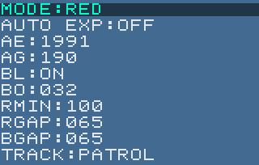
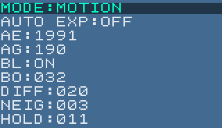
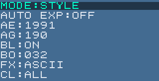
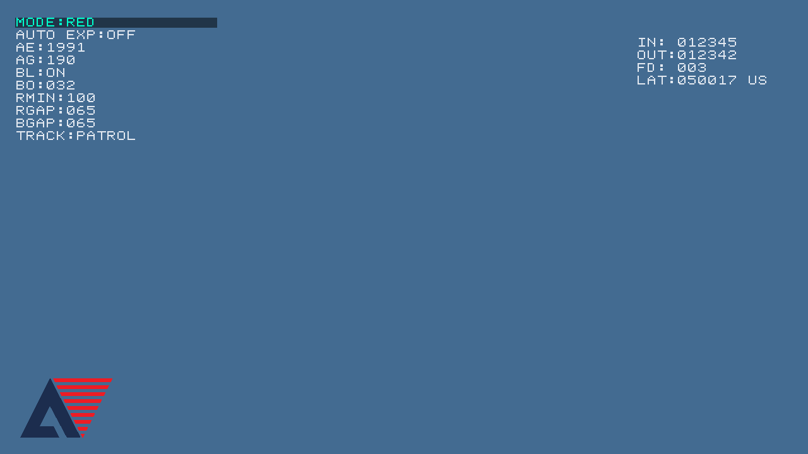

# 当前菜单

只显示可调项，无介绍标题、固定算法说明或CFG/I2C状态行。

| 顺序 | RED | MOTION | STYLE |
|---|---|---|---|
| 1 | MODE | MODE | MODE |
| 2 | AUTO EXP | AUTO EXP | AUTO EXP |
| 3 | AE | AE | AE |
| 4 | AG | AG | AG |
| 5 | BL | BL | BL |
| 6 | BO | BO | BO |
| 7 | RMIN | DIFF | FX RGB/CRT/PIX/HAT/NEG/ASCII |
| 8 | RGAP | NEIG | CL ALL/CLD/WRM |
| 9 | BGAP | HOLD | — |
| 10 | TRACK OFF/PATROL | — | — |

TRACK只有OFF/PATROL，无只跟踪档。默认OFF；PATROL下有目标跟踪，无合格目标水平巡航，俯仰逐步回中。原track on命令仅作为patrol的兼容别名。

菜单背景透明，文字浅灰，选中行文字青绿且背景视频减半；右侧延迟面板透明，完整彩色Logo在(32,600)，大小146×94。

GG为固定224/256、576行平台，不显示；LSC已删除。RED固定Gamma0.70、白平衡和STRONG滤波仍然有效。

面板x=24、y=24、宽320，字形16×16、行距20；RED高204、MOTION高184、STYLE高164。右侧延迟面板及Logo保留。menu_red.png、menu_motion.png、menu_style.png来自真实RTL输出像素；STYLE示例为ASCII，启动默认FX仍为RGB。截图数值来自回归测试场景，不代表全部上电默认值。

向下A9按表从上到下，向上D5反向循环，B9/C7调整。语义ID仍保留，STYLE跳过P3，MOTION跳过TRACK，所有模式跳过GMR。外部切换模式使当前项失效时回到MODE并等待松键。手动AE/AG关闭AUTO EXP；STYLE的select/value P3拒绝，GMR仅保留value GMR 70兼容命令。

采样间隔超过50ms时保留已消抖按键状态，仅重启候选电平和长按计时；同一次按住不会因主循环停顿而重复触发上下移动。新电平仍需连续观察20ms。回归与STYLE板级待查项见MENU_MODE_DEBUG.md。

HUD bit95=1直接表示PATROL；bit30/31仍保留为0。96位HUD字段、AHB地址、CDC request/ack、VS锁存及accepted/applied/generation语义不变。capability=0x70ff，bit7继续表示原HUD v2；新增bit12/13用于ASCII与本工程STYLE v2，bit14标识巡航菜单。不会采用队友冲突字段。菜单输出仍是原有一拍RGB/DE/HS/VS延迟，保留提前取字符和流水修复。

应用/BSP的.fd/project.json仍指向final，调试需使用final/FDWork/ph1p35_hello/build/ph1p35_hello.elf。新菜单bit与新ELF必须配套；只更新bit不能更新MCU导航。

验证证据见verification_summary.json的patrol_integration。Host生成102组真实HUD向量；mode_menu独立检查文字/光标，osd_timing与同一菜单的未流水参考逐像素比较。

## RTL菜单图

### RED

### MOTION

### STYLE

## 全画面预览

