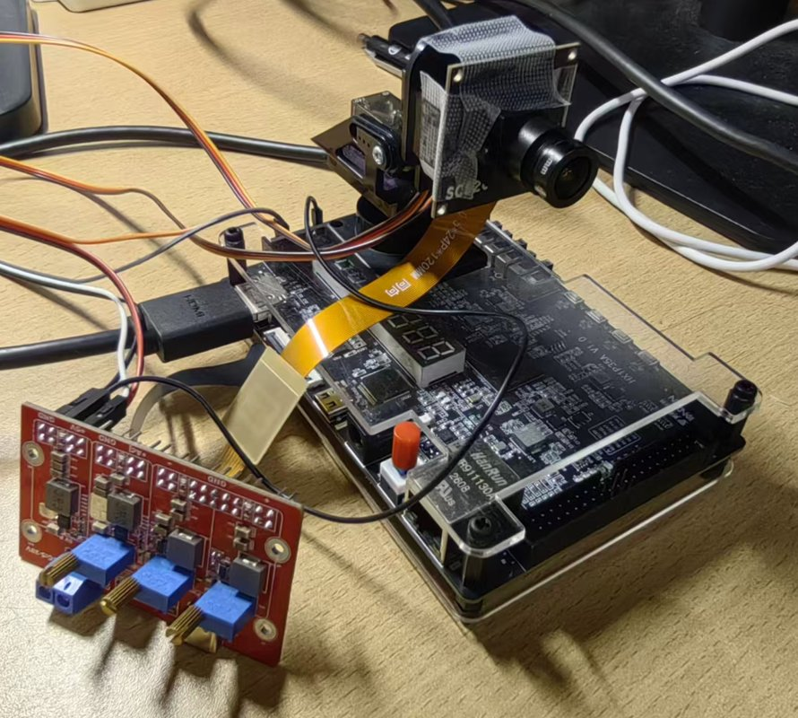
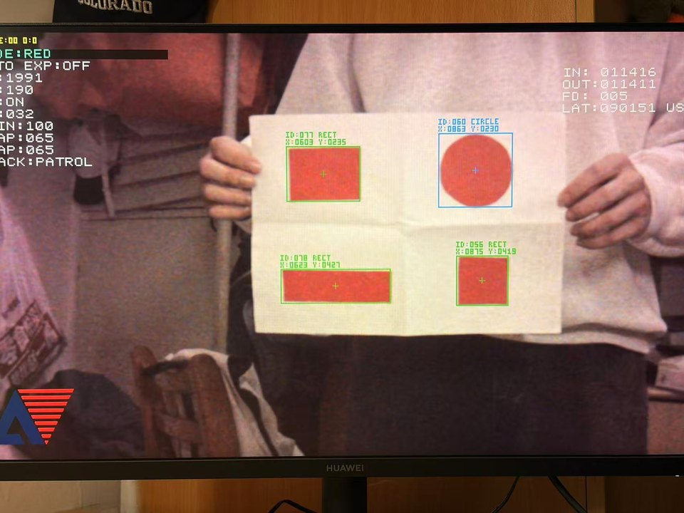
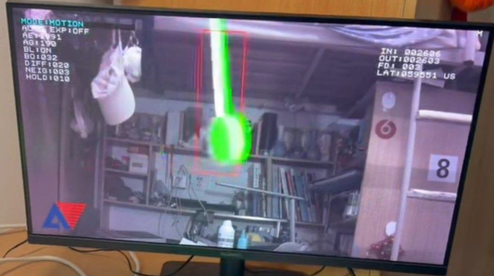
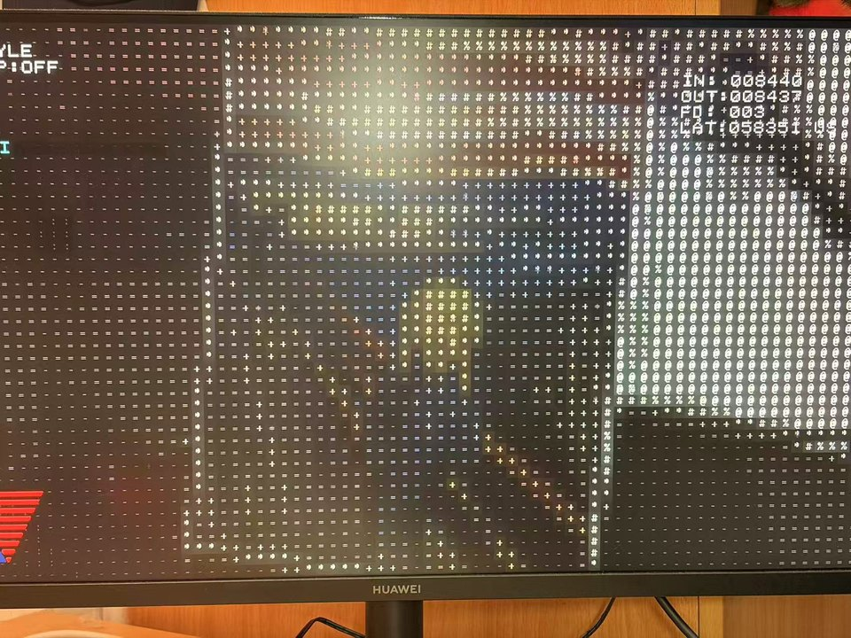
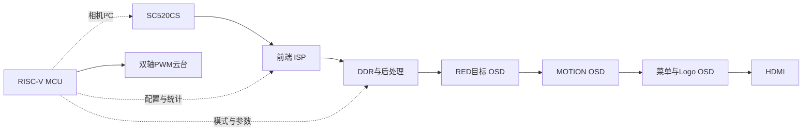

# PH1P35 多模式视觉处理与智能跟踪系统

基于安路 PH1P35 FPGA 与 RISC-V MCU 的视觉平台，集图像采集、实时处理、目标跟踪、自动曝光和 HDMI 显示于一体。



[效果展示](#效果展示) · [系统架构](docs/ARCHITECTURE.md) · [性能数据](docs/PERFORMANCE.md) · [快速开始](#快速开始) · [验证记录](docs/REPRODUCIBILITY.md)

## 主要功能

| 模式 | 功能与处理方式 |
| --- | --- |
| **RED** | 红色目标识别与圆形/矩形分类；检测支路固定白平衡与 Gamma 0.70，共享前端 STRONG 空间滤波；PATROL 下有目标跟踪、无合格目标巡航 |
| **MOTION** | 运动区域检测、定位与高亮，空间滤波旁路 |
| **STYLE** | AWB → 固定中心减绿（224/256）→ Gamma 0.55 → FX → CL，空间滤波旁路 |

- **六种风格**：RGB 原画、CRT 卡通、PIX 像素化、HAT 排线、NEG 反色、ASCII 彩色字符画。ASCII 使用 16×16 像素单元，720p 时输出 80×45 字符。
- **色彩选择**：全色 ALL、冷色 CLD、暖色 WRM。
- **自动曝光**：线性 RGB 亮度反馈，协同调节 AE / AG；默认关闭，目标亮度 80、死区约 ±5，支持相机参数确认与 NACK 重试。
- **手动调节**：AE 2..1991、AG 16..239；菜单按当前模式显示可调参数。
- **云台控制**：MG90S 双轴 PWM，TRACK 提供 OFF / PATROL 两档。

## 效果展示

以下为系统板级实拍，STYLE 以 ASCII 彩色字符画为例。

| RED · 目标识别与跟踪 | MOTION · 运动高亮 | STYLE · ASCII 字符画 |
| :---: | :---: | :---: |
|  |  |  |
| 目标分类与位置标注，配合双轴云台跟踪 | 突出运动区域，支持检测参数调节 | 16×16 像素映射为字符单元，保留色彩层次 |

## 关键设计特点

- **FPGA 与 MCU 分工**：FPGA 承担像素流水、统计和显示，MCU 完成候选目标后处理、曝光与白平衡计算、模式配置和云台控制。
- **共享前端与 DDR 后处理**：三模式复用四像素 RAW 前端及去马赛克，线性 RGB 经 DDR 缓存后以两像素/拍执行显示后处理。
- **帧级配置一致性**：跨时钟 mailbox 传递稳定配置，通过帧首应用、accepted/applied 确认及 generation 标记协调模式切换和结果归属。
- **闭环控制与故障恢复**：曝光统计取自白平衡/Gamma 前的线性 RGB；相机 AE/AG 八项参数整组确认，暂态 NACK 通过退避与重试恢复。

## 硬件与架构

| 部件 | 配置 |
| --- | --- |
| FPGA | 安路 PH1P35MDG324-3 |
| 相机 | SC520CS，两通道 CSI-2 / RAW10 |
| 图像通路 | 前端 4 像素/拍，DDR 后处理 2 像素/拍 |
| 控制核心 | RISC-V MCU，AHB 配置与统计接口 |
| 显示与执行 | HDMI 输出，MG90S 双轴云台 |

### 硬件准备与连接

| 硬件 | 用途 |
| --- | --- |
| PH1P35MDG324-3 开发板及适配电源 | 运行 FPGA 设计和 MCU 固件 |
| SC520CS 相机及适配连接线 | 通过两通道 CSI-2 输入图像 |
| HDMI 显示器及 HDMI 线 | 显示画面和操作菜单 |
| 两个 MG90S 舵机及双轴云台 | 可选；用于水平和俯仰跟踪 |
| 与开发板兼容的下载/调试设备及连接线 | 加载 FPGA 设计和 MCU 固件 |

按开发板与相机的接口定义连接相机、显示器和电源；使用云台时，将两个舵机的控制信号分别连接到水平与俯仰 PWM 输出。工程约束中水平信号为 FPGA 引脚 C18，俯仰信号为 D15（J2）；具体接插件针脚、舵机供电、共地及电源规格请以所用板卡和舵机资料为准，连接前核对，不能直接把 FPGA 引脚编号当作接插件针脚编号。顶部实物图可供参考。



模块职责、DDR 帧管理、控制接口及跨时钟机制见 [系统架构](docs/ARCHITECTURE.md)。

## 关键指标

| 指标 | 数值 | 来源 |
| --- | --- | --- |
| 图像尺寸 | 1280×720 | 当前 RTL 配置 |
| 像素并行度 | 前端 4 像素/拍，后处理 2 像素/拍 | 当前生产模块实例参数 |
| FPGA Slice | 18,390（86.68%） | 2026-10-31 TD 布局布线报告 |
| Setup / Hold 最差裕量 | +0.107 ns / +0.020 ns | 同一 TD 实现报告 |
| RAW 帧首至 HDMI 发送端首像素延迟 | 约 50～90 ms | 板级 LAT 调试计数观察 |

实现基线、LAT 测量端点及帧率口径见 [性能与测量](docs/PERFORMANCE.md)。

## 快速开始

准备 Windows、Git、Python 3、TD 和 FD；运行测试还需 MinGW GCC 与 ModelSim。工具版本和路径配置见 [环境与配置](docs/SETUP.md)。

**1. 克隆项目并进入目录**

```powershell
git clone https://github.com/TG6661/ph1p35-vision-system.git
cd ph1p35-vision-system
```

**2. 生成本机工程配置**

```powershell
./tools/prepare-local.ps1
```

**3. 构建 MCU 固件**

将 `E:/FD` 替换为本机 FD 安装目录：

```powershell
./FDWork/build.ps1 -FdRoot E:/FD
```

生成文件位于 `FDWork/ph1p35_hello/build/`。

**4. 打开开发工程**

- TD：`FPGA/td_project/camera_to_dsi_display.al`。
- FD：在新工作区中导入 `FDWork/MCU_startup` 和 `FDWork/ph1p35_hello`。
- TD 实现和板卡加载在开发工具中手动执行；配置与版本对应关系见 [环境与配置](docs/SETUP.md)。

## 功能验证

在仓库根目录执行，工具路径按本机安装位置填写：

```powershell
# 七组 Host 回归
./FPGA/sim/current/run_host.ps1 -Gcc D:/QT/Tools/mingw1310_64/bin/gcc.exe

# Host + RTL 功能回归
./FPGA/sim/current/run_validation.ps1 `
  -Gcc D:/QT/Tools/mingw1310_64/bin/gcc.exe `
  -Vsim D:/intelFPGA_lite/18.1/modelsim_ase/win32aloem/vsim.exe `
  -TdSimDir E:/TD/sim_release/ph1p
```

已验证源码提交 `516a995` 通过七组 Host 回归、24 项 RTL/集成检查及 RISC-V 固件构建，详见 [验证记录](docs/REPRODUCIBILITY.md)。

## 工程目录

| 路径 | 内容 |
| --- | --- |
| `FPGA/user_source/` | RTL、IP、ROM、引脚与约束 |
| `FPGA/td_project/` | TD 工程和项目 SDC |
| `FDWork/ph1p35_hello/` | MCU 应用与链接脚本 |
| `FDWork/MCU_startup/` | SDK / BSP |
| `FPGA/sim/current/` | Host 测试、RTL 仿真与回归脚本 |
| `tools/` | 工程配置与检查脚本 |
| `docs/` | 环境配置与技术文档 |

## 许可说明

SDK / BSP 的许可见 [LICENSE](FDWork/MCU_startup/LICENSE)，第三方代码与 IP 的说明见 [THIRD_PARTY.md](docs/THIRD_PARTY.md)。
