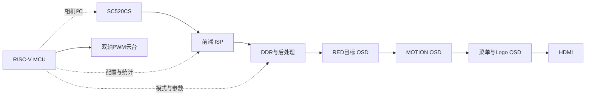

# PH1P35 多模式视觉处理与智能跟踪系统

基于安路 PH1P35 FPGA 与 RISC-V MCU 的视觉平台，集图像采集、实时处理、目标跟踪、自动曝光和 HDMI 显示于一体。


[快速开始](#快速开始) · [环境与配置](docs/SETUP.md) · [验证记录](docs/REPRODUCIBILITY.md) · [协作流程](CONTRIBUTING.md)

## 主要功能

| 模式 | 功能与处理方式 |
| --- | --- |
| **RED** | 红色目标识别与圆形/矩形分类；固定白平衡、Gamma 0.70、STRONG 空间滤波；PATROL 下有目标跟踪、无合格目标巡航 |
| **MOTION** | 运动区域检测、定位与高亮，空间滤波旁路 |
| **STYLE** | AWB → 固定中心减绿（224/256）→ Gamma 0.55 → FX → CL，空间滤波旁路 |

- **六种风格**：RGB 原画、CRT 卡通、PIX 像素化、HAT 排线、NEG 反色、ASCII 彩色字符画。ASCII 使用 16×16 像素单元，720p 时输出 80×45 字符。
- **色彩选择**：全色 ALL、冷色 CLD、暖色 WRM。
- **自动曝光**：线性 RGB 亮度反馈，协同调节 AE / AG；默认关闭，目标亮度 80、死区约 ±5，支持相机参数确认与 NACK 重试。
- **手动调节**：AE 2..1991、AG 16..239；菜单按当前模式显示可调参数。
- **云台控制**：MG90S 双轴 PWM，TRACK 提供 OFF / PATROL 两档。

## 硬件与架构

| 部件 | 配置 |
| --- | --- |
| FPGA | 安路 PH1P35MDG324-3 |
| 相机 | SC520CS，两通道 CSI-2 / RAW10 |
| 图像通路 | 前端 4 像素/拍，DDR 后处理 2 像素/拍 |
| 控制核心 | RISC-V MCU，AHB 配置与统计接口 |
| 显示与执行 | HDMI 输出，MG90S 双轴云台 |



## 快速开始

准备 Windows、Git、Python 3、TD 和 FD；运行测试还需 MinGW GCC 与 ModelSim。工具版本和路径配置见 [环境与配置](docs/SETUP.md)。

**1. 克隆项目并进入目录**

```powershell
git clone https://github.com/TG6661/ph1p35-vision-system.git
cd ph1p35-vision-system
```

也可在 GitHub Desktop 中选择 **File → Clone repository**。

**2. 生成本机工程配置**

```powershell
./tools/prepare-local.ps1
```

**3. 构建 MCU 固件**

将 `E:/FD` 替换为本机 FD 安装目录：

```powershell
./FDWork/build.ps1 -FdRoot E:/FD
```

生成文件位于 `FDWork/ph1p35_hello/build/`。

**4. 打开开发工程**

- TD：`FPGA/td_project/camera_to_dsi_display.al`。
- FD：在新工作区中导入 `FDWork/MCU_startup` 和 `FDWork/ph1p35_hello`。
- TD 实现和板卡加载在开发工具中手动执行；配置与版本对应关系见 [环境与配置](docs/SETUP.md)。

## 测试

在仓库根目录执行，工具路径按本机安装位置填写：

```powershell
# 文件依赖和脚本语法
python tools/check-repository.py
./tools/check-powershell.ps1

# 七组 Host 回归
./FPGA/sim/current/run_host.ps1 -Gcc D:/QT/Tools/mingw1310_64/bin/gcc.exe

# Host + RTL 功能回归
./FPGA/sim/current/run_validation.ps1 `
  -Gcc D:/QT/Tools/mingw1310_64/bin/gcc.exe `
  -Vsim D:/intelFPGA_lite/18.1/modelsim_ase/win32aloem/vsim.exe `
  -TdSimDir E:/TD/sim_release/ph1p
```

每次 Push / Pull Request，GitHub Actions 自动执行文件检查、脚本语法检查和七组 Host 测试。运行结果及日志可在 **Actions** 页面查看；完整本地验证见 [验证记录](docs/REPRODUCIBILITY.md)。

## 工程目录

| 路径 | 内容 |
| --- | --- |
| `FPGA/user_source/` | RTL、IP、ROM、引脚与约束 |
| `FPGA/td_project/` | TD 工程和项目 SDC |
| `FDWork/ph1p35_hello/` | MCU 应用与链接脚本 |
| `FDWork/MCU_startup/` | SDK / BSP |
| `FPGA/sim/current/` | Host 测试、RTL 仿真与回归脚本 |
| `tools/` | 本机配置和仓库检查工具 |
| `docs/` | 环境配置、验证记录与协作说明 |

源码与开发输入由 Git 管理，构建产物和运行日志保存在本地。协作开发请参阅 [CONTRIBUTING.md](CONTRIBUTING.md)，邀请队友的步骤见 [协作指南](docs/GITHUB_GUIDE.md#邀请队友)。第三方代码说明见 [THIRD_PARTY.md](docs/THIRD_PARTY.md)。
