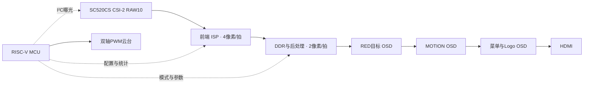

# PH1P35 多模式视觉处理与智能跟踪系统

基于安路 PH1P35 FPGA 与 RISC-V MCU 的视觉系统，集图像采集、三模式处理、HDMI 显示、自动曝光和双轴云台控制于一体。


[快速开始](#首次克隆后) · [协作流程](CONTRIBUTING.md) · [版本发布模板](docs/RELEASE_TEMPLATE.md) · [复现验证记录](docs/REPRODUCIBILITY.md)

## 功能

| 模式 | 当前功能 |
| --- | --- |
| RED | 红色目标识别与形状分类；固定白平衡、Gamma 0.70、STRONG 空间滤波；TRACK 为 OFF / PATROL，有目标跟踪、无合格目标巡航 |
| MOTION | 运动区域检测、定位和高亮；空间滤波旁路 |
| STYLE | AWB → 固定中心 GG 224/256 → Gamma 0.55 → FX → CL；LSC 已删除 |

- FX：RGB、CRT、PIX、HAT、NEG、ASCII；ASCII 使用 16×16 像素单元，720p 时为 80×45 字符。
- CL：ALL / CLD / WRM；菜单仅显示当前模式可调项。
- AUTO EXP 默认 OFF，目标线性亮度 80、死区约 ±5；统计位于白平衡 / Gamma 之前。
- AE 范围 2..1991，AG 范围 16..239；相机 VTS=1000。偏暗先增 AE，再增 AG；偏亮反序降低。
- 自动曝光最小决策间隔 100 ms，还需等待参数确认、80 ms 稳定期及足够新的源帧，不等同于板级实际 10 次/秒。
- 相机参数整组 ACK 确认，NACK 后退避并有限重试；双轴 PWM、AHB 外设控制与三级 OSD 保留。

## 硬件与数据通路

器件：PH1P35MDG324-3；相机：SC520CS；双轴云台：MG90S。



## 目录

| 路径 | 用途 |
| --- | --- |
| `FPGA/user_source/` | RTL、IP、ROM 初始化数据、引脚和约束 |
| `FPGA/td_project/camera_to_dsi_display.al` | TD 工程入口及项目 SDC |
| `FDWork/ph1p35_hello/` | MCU 应用、Makefile、链接脚本、FD 项目 |
| `FDWork/MCU_startup/` | 当前 SDK/BSP 和原有许可说明 |
| `FPGA/sim/current/` | 当前测试、仿真模型、回归脚本及设计说明 |
| `tools/prepare-local.ps1` | 克隆后生成本机 FD 路径配置；不启动开发工具 |
| `docs/GITHUB_GUIDE.md` | 首次发布、邀请队友、后续提交的详细步骤 |
| `docs/REPOSITORY_PREPARATION.md` | 上传范围、检查结果与本地保留内容 |
| `docs/THIRD_PARTY.md` | 第三方代码及 IP 许可边界 |

## 首次克隆后

1. 安装 TD、FD；可选安装 MinGW GCC 与 ModelSim。TD 项目记录版本为 6.2.168116，FD 工具版本记录来自 2026 年发行版。
2. 在仓库根目录的 PowerShell 执行：

```powershell
./tools/prepare-local.ps1
```

此脚本生成被 Git 忽略的 `.fd/project.json` 和 `.launch` 本机配置，并更新 TD 工程根路径。它不会运行综合、布局布线、bitgen 或下载。
3. FD 中导入本目录的 `MCU_startup` 与 `ph1p35_hello`，建议使用新的工作区，检查项目实际位置，避免重用旧路径。
4. 如需重新生成 BSP，需要先由用户从 TD 导出匹配的 HPF。当前源目录未包含 `.hpf`，已有 BSP/固件源码的命令行构建不依赖重新生成 BSP。

## 构建与验证

以下命令由用户按需执行。工具路径需替换为本机安装位置；本仓库不包含厂商工具安装包或授权文件。

```powershell
# 固件构建，不下载
./FDWork/build.ps1 -FdRoot E:/FD

# Host 回归，不访问 FPGA 或板卡
./FPGA/sim/current/run_host.ps1 -Gcc D:/QT/Tools/mingw1310_64/bin/gcc.exe

# Host + RTL 功能验证，不运行 TD 实现
./FPGA/sim/current/run_validation.ps1 `
  -Gcc D:/QT/Tools/mingw1310_64/bin/gcc.exe `
  -Vsim D:/intelFPGA_lite/18.1/modelsim_ase/win32aloem/vsim.exe `
  -TdSimDir E:/TD/sim_release/ph1p
```

脚本也支持环境变量 `FD_ROOT`、`HOST_GCC`、`MODELSIM_VSIM`、`TD_SIM_DIR`。固件构建输出在 `FDWork/ph1p35_hello/build/`；测试结果在 `FPGA/sim/current/runs/`，均不提交 Git。

TD 综合、布局布线、bitgen 和下载由用户手动操作。保留原工程实现设置，本次仓库整理不构成新的资源/时序签核。

## 自动检查

每次 Push / Pull Request 自动运行仓库输入检查、PowerShell 语法检查与七组 Host 测试。结果见仓库 **Actions** 页面，失败时可下载 Host 日志。基础 CI 不使用厂商工具，不运行 TD 实现或板卡下载。

本地执行：

```powershell
python tools/check-repository.py
./tools/check-powershell.ps1
```

检查依据 Git 跟踪列表；新增输入先 `git add` 再检查。工具路径示例和验证范围见 [协作流程](CONTRIBUTING.md)。

## bit / ELF 匹配

- ID：`0xA5010006`；扩展 ABI：`0x00010001`；当前 capability：`0x70ff`。
- bit4：自动曝光；bit12：ASCII；bit13：本工程 STYLE v2；bit14：巡航菜单外观。
- 不能混用队友 ABI1.14 或旧 ELF。下载前同时检查 bit 和 ELF 的来源与 capability。
- 已有板级问题曾与 FD 工作区引用旧工程有关；正确 ELF 的上板复测状态不能由源码或功能仿真代替。

## 上传与版本产物

源码、IP、ROM、约束、BSP 和测试输入提交 Git。现有本地 bit、ELF、MAP、实现数据库、日志与仿真编译库由 `.gitignore` 排除，**没有删除**。

克隆仓库不会自动获得这些构建产物。需要分享可运行版本时，先验证匹配的 bit / ELF，再以 GitHub Release 附件发布，并记录源码 commit、capability、工具版本和验证状态。

`FPGA/sim/current/` 中现有设计说明记录了此前验证过程；其中指向本地忽略日志的链接不保证在 GitHub 上可用，不能当作本次整理后的新验证。此次检查以 `docs/REPOSITORY_PREPARATION.md` 为准。

本仓库不声明未经确认的整机帧率、跟踪精度或最新资源/时序指标。第三方授权范围见 [THIRD_PARTY.md](docs/THIRD_PARTY.md)。
