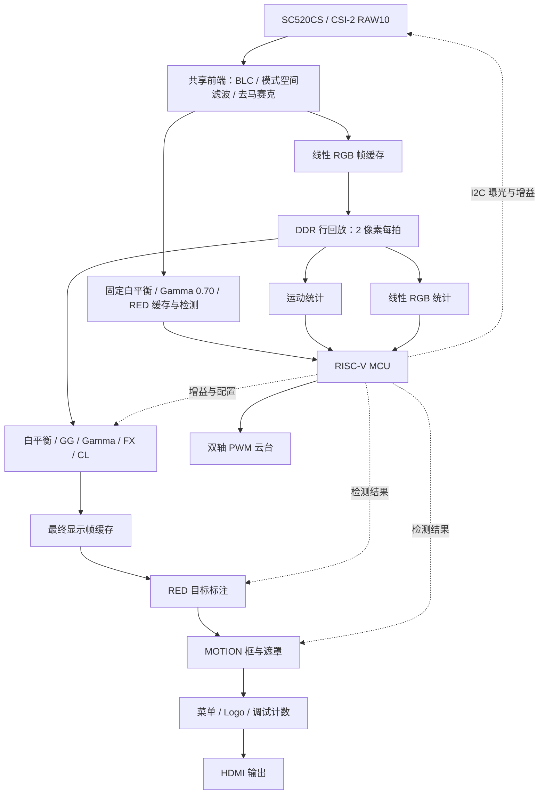

# 系统架构

系统以 PH1P35 FPGA 执行视频数据通路，以 RISC-V MCU 执行参数控制与检测结果后处理。生产顶层为 [design_top_wrapper.v](../FPGA/user_source/hdl_source/design_top_wrapper.v)，运行配置见 [环境与配置](SETUP.md)。

## 图像数据流

实线表示像素或统计数据流，虚线表示配置与检测结果回传。RED 检测支路与公共显示后处理分别使用自己的白平衡/Gamma 路径；RED Gamma 0.70 专用于检测输入校正。

## 处理链路与模式

共享前端在原始 RAW 帧首锁存 BL/BO，完成饱和减法黑电平校正。RED 选择 STRONG 同相位空间滤波，MOTION/STYLE 使用对齐旁路；之后复用一个四像素去马赛克实例，输出 RGB888。

| 模式 | 专用处理 | MCU 与显示行为 |
| --- | --- | --- |
| RED | 固定白平衡、Gamma 0.70、红色分割及候选目标提取 | MCU 对候选目标后处理、分类并回传标注；TRACK=PATROL 时跟踪目标，无合格目标时水平巡航 |
| MOTION | 8×8 分块运动检测与统计 | MCU 处理运动结果，显示框选/高亮及遮罩 |
| STYLE | AWB → 中心 GG → Gamma 0.55 → FX → CL | 菜单调节 FX 与 CL，使用对应特效输出 |

STYLE 中心 GG 固定为 224/256，纵向平台 576 行、上下各 64 行渐变。LSC 已移除，前端保留三拍直通以维持时序对齐。FX 支持 RGB、CRT、PIX、HAT、NEG、ASCII；CL 支持 ALL、CLD、WRM。NEG 在 Gamma 后、CL 前逐通道执行 `255-C`。ASCII 使用 16×16 单元，在 1280×720 下形成 80×45 字符网格。

不同 FX 分支具有不同流水延迟，输出选择器先完成当前帧，再等待目标分支的帧首，避免直接切断正在输出的图像。

## DDR 缓存与帧所有权

线性 RGB 帧与最终显示帧分别使用四个银行。下表地址单位为 **16 位字**，不是字节。

| 银行 | 线性 RGB 基址 | 最终显示帧基址 |
| --- | ---: | ---: |
| 0 | 3,500,000 | 0 |
| 1 | 10,500,000 | 7,000,000 |
| 2 | 17,500,000 | 14,000,000 |
| 3 | 24,500,000 | 21,000,000 |

这两组地址是公共显示通路的帧区；RED 检测与掩码客户端另有缓存需求。各客户端统一接入 [DDR 仲裁器](../FPGA/user_source/hdl_source/integration/final1_ddr_arbiter.v)。仲裁器保留突发写入所有权，并通过读请求 owner 队列将返回数据送回发起客户端；模式切换保留在途事务的归属信息。

[行回放模块](../FPGA/user_source/hdl_source/integration/final1_line_replay.v)选择已完成的线性帧，锁定读取银行，并携带源帧号和 generation。后处理按固定行节奏读取两像素 RGB 数据，完成整帧后发布最终显示帧。显示侧按帧选择银行，三级 OSD 顺序固定为 **RED 目标 → MOTION → 菜单/Logo**。

## 模式切换与跨时钟

主要时钟域为 CSI 接收、DDR 用户接口、MCU AHB 和 HDMI 像素域。跨域多位配置采用稳定载荷加 request/ack 握手的 [mailbox](../FPGA/user_source/hdl_source/integration/final1_mailbox.v)；复位异步置位，在各域经过三个本地时钟边沿释放。

[运行控制器](../FPGA/user_source/hdl_source/integration/final1_runtime.v)按以下顺序切换模式：

1. 接收 AHB 提交的配置，并向相机域发送停止请求。
2. 相机域在 RAW 帧首应用停止请求，当前在途帧继续完成。
3. 等待采集、回放、检测与最终帧写入达到可切换状态。
4. 更新模式参数和 generation，再向相机域发送启动请求。
5. 相机域在帧首应用新配置，控制器回传 applied 确认。

accepted 表示请求已接收，applied 表示相应配置已经生效。源帧号标识图像来源，generation 标识配置代次，二者用于区分切换前后的统计与结果。CDC 约束入口为 [项目 SDC](../FPGA/td_project/camera_to_dsi_display.sdc)。

## 自动曝光与白平衡

[awb_mcu96.v](../FPGA/user_source/hdl_source/integration/awb_mcu96.v)在白平衡和 Gamma 之前统计线性 RGB 通道和与样本数。运行控制器补充源帧号与 generation，经快照接口交给 MCU。固定白平衡模式下仍持续发布曝光统计。

[曝光服务](../FDWork/ph1p35_hello/exposure_service.c)默认目标亮度为 80、死区约 ±5；偏暗先增加 AE，再增加 AG，偏亮按相反顺序降低。AE 范围 2..1991，AG 范围 16..239。决策间隔至少 100 ms，参数成功确认后稳定等待 80 ms，并检查更新的源帧；具体调节节奏取决于统计帧与相机事务完成时间。MOTION 在曝光收敛或调节窗口结束后锁定曝光、重建运动背景；持续严重亮度偏差会触发重新调节。

[相机服务](../FDWork/ph1p35_hello/camera_service.c)执行 [SC520CS 初始化表](../FDWork/ph1p35_hello/sc520_regs.h)以及 AE/AG 参数事务。参数组八项全部 ACK 后确认 applied；失败后等待约 5 ms，使用冻结的参数整组重试，最多额外两次。历史 NACK 留作诊断，持续失败或超时进入故障状态。

AWB 由 [integration_service.c](../FDWork/ph1p35_hello/integration_service.c)计算增益，再经握手传回 FPGA，在帧边界应用。自动曝光控制相机 AE/AG，AWB 控制数字通道增益，两者共用线性统计，但执行不同的反馈控制。

## 控制接口与模块入口

AHB 外设基址为 `0x80000000`，下表为相对偏移；寄存器定义以 [fabric_regs.h](../FDWork/ph1p35_hello/fabric_regs.h)及 [final1_regs.v](../FPGA/user_source/hdl_source/integration/final1_regs.v)为准。

| 偏移 | 用途 |
| --- | --- |
| `0x000` | 工程 ID：`0xA5010006` |
| `0x064..0x074` | 双轴舵机设置、提交与活动状态 |
| `0x080..0x0BC` | RED 候选目标快照与结果回传 |
| `0x100..0x120` | 相机 I2C 事务与状态 |
| `0x140..0x158` | 96 位菜单 HUD 提交与确认 |
| `0x180 / 0x184` | 扩展 ABI `0x00010001` / capability `0x70ff` |
| `0x188..0x19C` | 模式配置、提交、状态及 accepted/applied generation |

菜单按模式显示可调项目：RED 10 项、MOTION 9 项、STYLE 8 项。TRACK 仅在 RED 中提供 OFF/PATROL；[gimbal_track.c](../FDWork/ph1p35_hello/gimbal_track.c)依据新的检测结果控制双轴 PWM，水平方向巡航范围为 900..2100 μs。

| 工程入口 | 责任 |
| --- | --- |
| [final1_raw_front.v](../FPGA/user_source/hdl_source/integration/final1_raw_front.v) | 公共 BLC、空间滤波和去马赛克 |
| [final1_post.v](../FPGA/user_source/hdl_source/integration/final1_post.v) | 两像素显示后处理及 FX 帧选择 |
| [isp_top.v](../FPGA/user_source/hdl_source/isp/isp_top.v) | RED 固定白平衡与 Gamma 检测输入 |
| [target_processing.c](../FDWork/ph1p35_hello/target_processing.c) | RED 候选目标后处理 |
| [motion_processing.c](../FDWork/ph1p35_hello/motion_processing.c) | 运动统计后处理 |
| [menu_control.c](../FDWork/ph1p35_hello/menu_control.c) | 按键与模式菜单导航 |
| [video_out.v](../FPGA/user_source/hdl_source/video_out.v) | 显示帧读取及 LAT 测量实现 |

构建与回归入口见 [README](../README.md#功能验证)，测试结果见 [验证记录](REPRODUCIBILITY.md)，资源与延迟口径见 [性能与测量](PERFORMANCE.md)。
